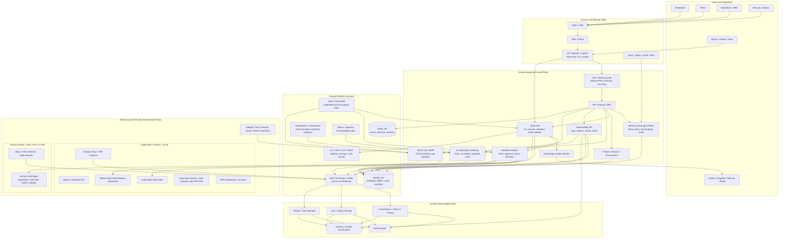

# AxiOps Enterprise Operations Architecture

## 1. Purpose and Boundaries

AxiOps is an enterprise platform for cloud-native and hybrid-cloud operations.
It provides one control plane for identity, CMDB/assets, Kubernetes, CI/CD,
logs, metrics, alerts, audit, and AI-assisted operations. It does not replace
the cloud provider control plane or directly expose production credentials to
developers.

The primary domain model is:

```text
Organization -> Department -> User -> Role Binding -> Scope
Project -> Service -> Environment -> Workflow -> Run -> Deployment / Artifact
Cloud Account -> Region -> Asset / Host / Cluster -> Telemetry
```

Initial capacity targets:

| Area | Target | Architecture implication |
| --- | ---: | --- |
| Developers | 100+ | Project-scoped RBAC, self-service and audit |
| Hosts | about 5,000 | Agent-based telemetry and pull-based delivery |
| Kubernetes clusters | 10 initially, 20-50 planned | Multi-cluster connection registry and regional collectors |
| Networks | multi-cloud, multi-region, private and restricted | Outbound-only Agent/Collector connections and mTLS |
| Availability | enterprise production | HA database/cache, queues, object storage, DR and observability |

## 2. Architecture Principles

1. **Control plane and data plane are separated.** AxiOps stores intent,
   metadata, authorization and audit. Clusters and hosts execute work locally.
2. **Everything is scoped.** Every read and write is constrained by platform,
   project, service, environment, cluster and build scopes. Explicit deny has
   priority over allow.
3. **Restricted networks pull outward.** Host Agents and telemetry collectors
   initiate outbound mTLS connections. The platform does not retain SSH private
   keys or initiate arbitrary inbound connections to production hosts.
4. **Configuration and delivery are immutable.** Git commit, service revision,
   image digest, artifact SHA-256 and rendered deployment snapshot are retained
   for a run. Production changes require approval and audit.
5. **Events are durable.** Build commands, workflow tasks, notifications and
   webhooks use leases, idempotency keys and durable outboxes instead of process
   memory.
6. **Observability is a product capability.** Metrics, logs, traces, events and
   topology share a consistent identity model: cloud account, region, cluster,
   namespace, project, service, environment and workload.
7. **AI is assistive and policy-bound.** AI can retrieve, summarize, correlate
   and propose actions. Any write action passes the same RBAC, approval, audit
   and workflow APIs as a human operation.

## 3. Target Architecture



## 4. Layer Responsibilities and Technology Choices

| Layer | Current AxiOps components | Recommended enterprise additions | Responsibility |
| --- | --- | --- | --- |
| Web console | Vue 3, Vite, TypeScript, Element Plus, ECharts, Vue Flow | BFF routing, Playwright, design tokens | Project workbench, DAG, logs, dashboards, approval |
| Edge | Go REST services | Nginx Ingress or Envoy Gateway, WAF, API rate limits | TLS termination, path routing, request limits |
| Identity | JWT, SQL scoped RBAC, menu permission, audit middleware | OIDC/SAML/LDAP, MFA, SCIM, session revocation | SSO, users, departments, role binding, visible menus |
| Core services | Go, go-zero REST, MySQL | Service registry only when multiple deployment units require it | Project, asset, K8s, CI/CD, logs, monitoring APIs |
| Workflow | Custom DAG, task lease, approval, recovery | NATS JetStream events, distributed scheduler metrics | Durable orchestration, idempotency and restart recovery |
| Build and artifact | Kubernetes Job provider, build logs, image digest, artifact validation | Harbor, cloud registry, OCI artifact store, SBOM/signing | Immutable build output and supply-chain metadata |
| K8s delivery | Kubernetes Server-Side Apply, revision/snapshot rollback | Official Helm v3 SDK, Argo Rollouts optional | YAML, Helm, progressive delivery and rollback |
| Host delivery | Pull-based AxiOps Host Agent | mTLS enrollment, package mirror, batch strategy | Restricted-network deployment, health and rollback |
| CMDB/assets | Cloud asset synchronization and K8s management | Cloud provider adapters, topology graph, reconciliation jobs | Unified hosts, clusters, cloud accounts, ownership |
| Metrics | Existing monitoring module | Prometheus, Mimir/Thanos, Alertmanager, Grafana | Long retention, multi-cluster aggregation and alerting |
| Logs | Loki already selected | Grafana Alloy/Fluent Bit, Kafka buffer, object storage archive | Structured logs, labels, retention, search and export |
| Traces | Not yet integrated | OpenTelemetry Collector, Tempo | Service dependency and release impact analysis |
| Secrets | AES-GCM credential storage | Vault or cloud KMS, External Secrets Operator | Envelope encryption, rotation and short-lived credentials |
| Data services | MySQL and Redis | MySQL InnoDB Cluster, Redis Sentinel/Cluster, object store, ClickHouse/OpenSearch | Metadata, cache, artifact, audit and analytics persistence |
| AI operations | Planned | Model gateway, RAG, vector DB, policy tool gateway | Incident correlation, runbook Q&A, proposed changes |

## 5. Core End-to-End Chains

### 5.1 CI/CD Delivery Chain

```text
Developer commit
  -> Git webhook signature verification
  -> delivery ledger and branch rule match
  -> immutable build_run and build_command
  -> Kubernetes Job build / external builder
  -> image digest + artifact URL + SHA-256 + log snapshot
  -> workflow DAG scheduling and approval gate
  -> YAML Server-Side Apply OR Helm upgrade/install OR Host Agent pull command
  -> health verification and deployment snapshot
  -> notification outbox
  -> audit event, metrics, logs and release dashboard
```

Production requirements: immutable digest or SHA-256, production approval,
least-privilege target access, stable idempotency key, audit record and
rollback input. Developers may view only authorized projects, environments,
services, build logs and clusters; production deploy/rollback is separately
granted.

### 5.2 Multi-cloud Asset and Topology Chain

```text
Cloud account credential (Vault/KMS reference)
  -> cloud adapter polling or provider event subscription
  -> raw inventory snapshot
  -> normalized asset model (account, region, VPC, host, LB, disk, cluster)
  -> ownership and project/environment relationship
  -> topology graph and CMDB API
  -> monitoring/log labels and RBAC scope propagation
```

Cloud synchronization is read-only by default. Any cloud write operation is a
separate workflow node with explicit permission, approval and audit.

### 5.3 Metrics, Logs, Traces and Alert Chain

```text
Application SDK / exporter / node agent
  -> regional Alloy or OpenTelemetry Collector
  -> authenticated remote-write / log ingest / trace ingest
  -> Kafka or NATS buffering where network pressure requires it
  -> Mimir/Thanos, Loki and Tempo
  -> alert rules and Alertmanager grouping
  -> AxiOps alert event, notification, incident and runbook context
  -> Grafana/AxiOps dashboard and AI correlation
```

Required common labels: `cloud_account`, `region`, `cluster`, `namespace`,
`project`, `environment`, `service`, `workload`, `instance`, `owner` and
`cost_center`. Label cardinality must be controlled: do not use request IDs,
unbounded URLs or arbitrary user input as Prometheus labels.

### 5.4 AI-Assisted Operations Chain

```text
Authorized user question or alert event
  -> AI gateway authenticates user and loads RBAC scopes
  -> retrieve only authorized runbooks, audit, metrics, logs and topology
  -> model summarizes root-cause hypotheses and cited evidence
  -> optional proposed workflow action
  -> policy tool gateway checks RBAC, environment and approval requirements
  -> normal AxiOps workflow execution and immutable audit record
```

AI must never directly query unrestricted production logs, receive plaintext
credentials, invoke shell commands, or bypass workflow approval.

## 6. Data Placement and Availability

| Data | Primary store | Availability and retention |
| --- | --- | --- |
| RBAC, workflow, project, asset metadata | MySQL HA | 3-node or managed HA, PITR, daily backup and restore drill |
| Cache, rate limiting, short leases | Redis HA | Sentinel/Cluster, no authoritative workflow state only in Redis |
| Build artifacts, Helm packages, snapshots, log chunks | S3-compatible object storage | Versioning, lifecycle archive, cross-region copy for critical data |
| Metrics | Mimir or Prometheus + Thanos | Regional ingestion, object-store long retention |
| Logs | Loki | Object-store chunks, retention by tenant/project, archive policy |
| Traces | Tempo | Sampling policy and object-store retention |
| Audit/search analytics | ClickHouse or OpenSearch | Immutable append workflow, retention based on compliance requirement |
| Events | NATS JetStream initially, Kafka when sustained log/event throughput requires it | At-least-once consumption with idempotent consumers |
| AI knowledge | Vector DB plus object store | Tenant/project metadata filters, source citations and deletion lifecycle |

For an initial 5,000-host deployment, use regional telemetry collectors and
remote-write fan-in. Do not send every agent directly to a single central
Prometheus or Loki instance. Start with object-storage-backed Loki and Mimir /
Thanos; introduce Kafka when burst ingestion, replay or cross-team consumers
make a durable high-throughput bus necessary.

## 7. Security and Compliance Controls

| Control | Design requirement |
| --- | --- |
| Identity | OIDC/SAML/LDAP federation; MFA for privileged users; disable local break-glass except documented emergency access |
| Authorization | SQL scoped RBAC with deny precedence; menu visibility is separate from API enforcement |
| Credential handling | Vault/KMS reference or AES-GCM ciphertext; decrypt only in the execution process; never place secrets in logs, snapshots or browser state |
| Network | Private endpoints, egress-only Agents, mTLS enrollment, per-region gateways, no inbound SSH requirement |
| Kubernetes | Separate service accounts per cluster/environment, namespace RBAC, admission policy, image policy and network policy |
| Supply chain | Commit SHA, image digest, artifact SHA-256, SBOM, vulnerability scan, image signing verification before production |
| Audit | Append-only audit events for authorization changes, credential access, workflow runs, approval, deployment and rollback |
| Data protection | Encrypted backups, key rotation, log PII masking, retention/lifecycle policy and restore exercises |
| AI | Tenant scope filter before retrieval, prompt-injection filtering, tool allow list, human approval for writes, full tool-call audit |

## 8. Deployment Topology

```text
Global DNS / WAF
  -> Region A control-plane Kubernetes (active)
       -> 3+ API replicas, 2+ workflow workers, notification workers
       -> MySQL HA, Redis HA, NATS, object-store endpoint
       -> regional observability collectors
  -> Region B control-plane Kubernetes (standby or active-active by service)
       -> replicated object storage / backup and DR runbooks
  -> private cloud / VPC / IDC data planes
       -> cluster collectors and host Agents initiate outbound mTLS only
```

Use stateless API replicas behind the gateway. Workflow task ownership belongs
to the database lease, not a pod. A worker restart must not duplicate a build,
deployment or notification. Database and object-store recovery objectives must
be written per environment; a typical starting point is RPO <= 15 minutes and
RTO <= 4 hours for the platform metadata plane, then refine by business tier.

## 9. Delivery Roadmap

### Stage A: Establish the usable platform

- Complete unified API gateway paths for Platform API and CI/CD API.
- Implement CI/CD frontend workbench: project, service, environment, workflow
  editor, run detail, logs, approval and notification subscription.
- Run MySQL-backed API integration tests and permission matrix tests.
- Add production configuration injection for encryption key; remove secrets
  from committed YAML configuration.

### Stage B: Complete three delivery types

- YAML: real cluster E2E build, apply, snapshot and rollback.
- Host: real Agent enrollment, artifact delivery, health and rollback E2E.
- Helm: add official Helm v3 SDK dependency, chart resolver, status, rollback
  and E2E. Do not replace this with a custom template renderer.

### Stage C: Observability and asset scale-out

- Deploy regional Alloy/OTel collectors, Prometheus/Mimir or Thanos, Loki,
  Tempo and Alertmanager.
- Normalize Alibaba Cloud and Tencent Cloud assets; bind project ownership and
  topology labels.
- Add SLO, capacity, cost and release-impact dashboards.

### Stage D: AI-assisted operations

- Ingest approved runbooks, events and historical incidents with citations.
- Add readonly diagnosis first, then gated workflow proposals.
- Measure answer accuracy, tool-call success, permission denials and incident
  resolution impact before allowing broader automation.

## 10. Image Generation Prompt

Use the following prompt with an image-generation AI. Keep all visible text in
Chinese, but retain product and technology names in English where stated.

```text
绘制一张 16:9 横向、超高清、企业级“ AxiOps 全域运维技术架构与业务链路图”。
风格：现代 B2B 云原生平台架构图，白色或极浅灰背景，深青色、蓝色、绿色、橙色少量点缀；
严格网格布局、细线连接、清晰箭头、技术图标和中文标签；不要营销海报、不要人物、不要渐变光球、
不要卡通。标题放在顶部中央：“AxiOps 企业级云原生与混合云全域运维平台”。

从上到下画 6 层，所有连线必须表达方向：
第一层“用户与生态”：开发人员、测试人员、运维/SRE、安全审计、GitLab/GitHub/Gitea、
飞书/钉钉/企业微信/邮件。
第二层“统一访问与安全边界”：DNS/CDN、WAF/DDoS、API Gateway/Ingress、OIDC/SAML/LDAP/MFA。
第三层“AxiOps 控制平面”：Vue 3 Web Console、BFF/API Gateway、身份与细粒度 RBAC、
项目/服务/环境中心、CI/CD API、DAG Workflow Worker、资产/CMDB、日志监控告警 API、
AI Ops Gateway、通知 Outbox Worker。
第四层“共享平台服务”：MySQL HA、Redis HA、NATS JetStream/Kafka、
S3/OSS/COS/MinIO Object Storage、Vault/Cloud KMS、ClickHouse/OpenSearch、Milvus/pgvector。
第五层“多云与受限网络数据平面”：左侧多个 Kubernetes 集群（20-50），内部包含
Kubernetes Build Job、Server-Side Apply、Official Helm SDK、Grafana Alloy/OTel Collector、
kube-state-metrics/node-exporter、OPA Gatekeeper/Kyverno；右侧 5000 台 ECS/物理机/虚拟机，
内部包含 AxiOps Host Agent（主动拉取部署、SHA-256 校验、健康检查、回滚）和 Alloy/OTel/node-exporter；
底部包含阿里云、腾讯云和其他云 API。
第六层“统一可观测平台”：Prometheus + Mimir/Thanos、Loki + Object Storage、Tempo、
Alertmanager、Grafana/AxiOps Dashboards。

必须突出 4 条彩色业务链路并在图旁用小号中文注释：
1. CI/CD 发布链路：Git Commit -> Webhook 验签 -> Build Job -> 镜像 Digest/制品 SHA-256 ->
工作流审批 -> YAML/Helm/Host Agent 发布 -> 健康检查/回滚 -> 通知/审计。
2. 可观测链路：应用和主机遥测 -> 区域 Collector -> 消息缓冲 -> Metrics/Logs/Traces ->
Alertmanager -> AxiOps 告警与通知。
3. 资产链路：云 API -> 资产同步 -> 统一 CMDB/拓扑 -> 项目和环境关联 -> 监控日志标签。
4. AI 运维链路：告警/用户问题 -> RBAC 过滤 -> RAG 知识库 -> AI 根因分析 ->
受策略控制的工作流建议 -> 审批和审计。

在图右下角增加“安全原则”小区：最小权限、显式拒绝优先、密钥不落日志、私网 Agent 仅主动出站、
生产审批、不可变制品、全链路审计。在图左下角增加“规模目标”：100+ 开发人员、5000 主机、
20-50 Kubernetes 集群、多云多区域和受限网络。
```

## 11. Architecture Review Checklist

- Does every API and telemetry record carry a project/environment/asset scope?
- Can a worker or Agent restart without duplicating an external action?
- Are production credentials absent from browser state, logs and workflow snapshots?
- Does every production deployment have immutable input, approval and rollback?
- Can a region lose connectivity while local workloads and collectors continue safely?
- Are log and metric label cardinality, retention and object-store cost bounded?
- Can an auditor reconstruct who approved, executed and observed a change?
- Can AI explain its evidence and is every write action subject to policy?
